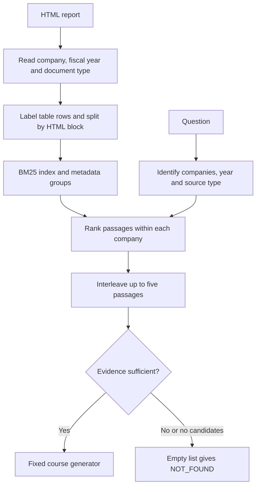

# FTEC5660 Homework 4

## Homework 4 solution

Given an analyst's question, the retriever must select up to five passages that establish the answer. A comparison needs evidence for both companies. An empty list tells the runner to return `NOT_FOUND`.



The parser takes the company from the masthead and the fiscal year and report type from the title. Each serialized table retains its caption, with column labels repeated alongside the values on each row. Each HTML block receives its section heading and is split at a line or word boundary to stay within 1,500 characters. The index groups these blocks by company and source type. The query parser matches company names against the corpus and uses the permitted model to extract unfamiliar or ambiguous names. Annual-report retrieval prefers the named reporting year and falls back to the following report for its comparative column. Calls and broker notes can discuss future years, so those searches retain the requested source type without an exact report-year filter. Within each company, BM25 scores the metric words after punctuation removal and light synonym normalization. Numerical questions give a small bonus to labeled table rows. Alternating between company rankings gives both sides of a comparison room in the five passages. The final evidence check asks the course model whether those passages disclose every requested fact before passing them to the fixed generator.

### Public ablation study

Each row changes one pipeline component from the row above. All six runs use the same 40 documents, 60 questions and course generator. Recall requires evidence for every requested fact on each of the 46 answerable questions. Rejection is measured on the 14 unanswerable questions. Every variant kept all 46 answerable questions and passed the document checks on all 40 documents.

| Run | Component changed | Table cells | Query fields | Recall@5 | Rejected | Correct answers | Points / 75 | Seconds |
|---|---|---:|---:|---:|---:|---:|---:|---:|
| B0 | Required naive RAG | 0% | 0% | 13/46 | 0/14 | 25/60 | 20.33 | 5.2 |
| V1 | Serialize tables with row and column labels | 100% | 0% | 10/46 | 0/14 | 24/60 | 28.00 | 5.8 |
| V2 | Switch to section-labeled HTML blocks | 100% | 0% | 8/46 | 0/14 | 21/60 | 27.00 | 9.0 |
| V2S | Route candidates by parsed metadata | 100% | 100% | 29/46 | 10/14 | 44/60 | 56.70 | 7.7 |
| V3 | Replace the within-group lexical scorer | 100% | 100% | 46/46 | 10/14 | 60/60 | 72.14 | 8.9 |
| V4 | Apply the evidence sufficiency check | 100% | 100% | 46/46 | 14/14 | 60/60 | 75.00 | 36.7 |

B0 uses BeautifulSoup plain text, recursive splitting at 1,100 characters with 100 characters of overlap, the required metadata, and global whitespace-tokenized BM25 top five. It never abstains. V1 makes all tested table cells readable. For q051 it recovers the receivables figure of 492.1 that B0 missed. Overall recall nevertheless falls by three questions. Repeating years and column labels changes chunk boundaries and BM25 term frequencies. A more readable table can still lose its place in a global ranking.

V2 raises the number of chunks from 376 to 2,658. A paragraph or table can now be ranked independently, but similar section titles recur across issuers. Global retrieval loses another two evidence hits. V2S retains the whitespace scorer and uses the parsed entities, report type and reporting period to construct a candidate list per company. This recovers 21 additional hits and rules out ten unsupported requests. V3 changes the scoring of those same candidates. Removing company and calendar terms from the scoring query, normalizing metric words and favoring tables for numerical requests together recover the remaining 17 hits. This experiment measures the scorer as a unit and does not estimate each scoring feature's individual contribution.

V4 changes four decisions from returning passages to returning an empty list. In V3 the generator had already declined those four questions. The evidence check therefore improves Task 3 by 2.86 points while answer accuracy stays at 60/60. The trade-off is visible in runtime. V4 used five company-extraction calls, 50 evidence checks and 46 generator calls. The course runner estimated USD 0.0133 for this run.

### Error analysis

* **Two correct files can still yield a wrong comparison.** For q021, V2S selected both companies' FY2024 reports but missed at least one required figure and answered Northgate Payments. V3 selected passages from the same two files that contained 215.7 and 114.5. With both cash balances available, the generator chose Northgate Robotics.
* **A similar company name can produce a plausible number.** For q001, B0 answered 241.6 for a company absent from the library. V2S retained the full company name during parsing, found no matching issuer group and returned an empty list.
* **A valid company and year do not establish disclosure.** In q033 the question requests revenue from the largest single customer. V3 returned the correct issuer's report, and the generator declined to answer. V4 rejected the passages at retrieval time. This example explains how answer accuracy can hide retrieval errors.
* **A remaining limitation** is the assumption that an available annual report for the requested year takes priority. If an issuer discloses a restatement only in a later report, this policy could miss it. The perfect public score covers this corpus and these phrasings. There is no private-set measurement.

### Reproduction

Use Python 3.10 or newer and install the packages in `requirements.txt`. Set `DEEPSEEK_API_KEY` locally. The final system builds a fresh index at startup and requires no saved index. The submitted run used Python 3.14.2 on Windows. From the repository root run

```console
python -m pip install -r requirements.txt
python hw4.py --data-folder public_test --output results.csv
```

To reproduce an ablation, run `python ablation.py V2S --output experiments/V2S.csv`, substituting B0, V1, V2, V2S, V3 or V4 as appropriate. The experiments directory contains the runner summaries and intermediate per-question outputs. The final per-question output is in [results.csv](results.csv). Model responses and elapsed times may vary between runs.

## Task 6 reflection

Ten years from now, I still want to be the person who decides what is worth learning and which idea deserves a first experiment. If I ask an agent for an explanation and immediately understand its wording, it is easy to mistake that feeling for understanding the subject. A better test is whether I can close the explanation, predict what will happen in a new case, and explain why my prediction might fail.

The cash-balance question in this assignment gives me a concrete example. If someone had shown me two correct annual reports and asked whether retrieval had succeeded, I might have said yes. Looking for the two actual figures changes the question I ask. What evidence would let someone else check this conclusion? I would like to carry that habit into work with other people. Beyond what I produce, I would like to be known as someone who listens carefully, explains a decision honestly and changes their mind when a colleague finds a counterexample.

I am willing to struggle through the first attempt at a new idea, including the period when I cannot yet express it clearly. That is when I decide which assumptions I actually believe. An agent can help me find a weakness, suggest an experiment or show me an unfamiliar viewpoint. I want to keep responsibility for choosing the question and deciding what the result means. Curiosity, judgment and the willingness to be corrected would still matter to me even if producing a polished answer took only seconds.

Tomorrow, when I encounter a new concept, I can write a short explanation and one testable prediction before opening an AI tool. Then I can ask the agent for the strongest counterexample and keep a record of what I changed. That gives AI a specific role in my learning while leaving the original question, the first idea and the final judgment in my hands.
